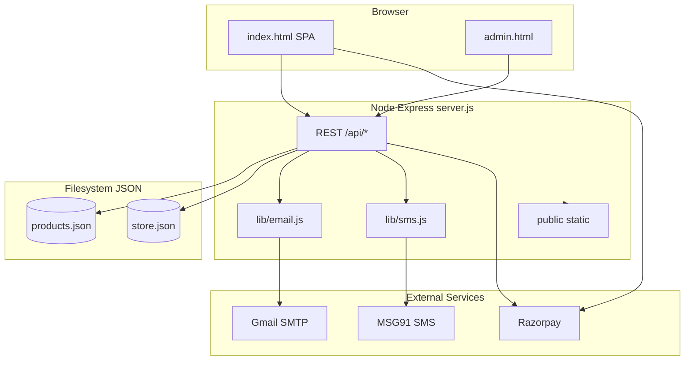

# VELVETCLAP25 — Complete Project Documentation

**Version:** 1.0 (documentation) · **Application:** `package.json` v1.0.0  
**Repository:** [github.com/Gautampaswan/velvetclap25](https://github.com/Gautampaswan/velvetclap25)  
**Evidence base:** Source tree, `README.md`, `STAFF-GUIDE.md`, `.env.example`, `render.yaml`, partial Cursor agent transcript (`c2fb0938-696c-464f-a322-e05b967a49ab`).

---

## A. Project Overview

### Project name and purpose

**VELVETCLAP25** is a demo/production-ready **Indian streetwear e-commerce storefront** (“vault”) showcasing products **under ₹999**, with a dark, high-contrast UI originally derived from a static HTML mock (`velvetclap25.html`) and extended with a **Node.js/Express API**, **JSON persistence**, **guest checkout**, **staff admin**, and **Render** deployment.

### Business goals (inferred from chat + copy)

- Client-demo **live shop** on the internet (Render).  
- Enable **shop staff** to add real product photos and SKUs without developer for every change.  
- Support **COD** and optional **online pay (Razorpay)** for credible checkout demos.  
- Notify shop on **new orders** and **shipped** status (email and/or SMS).  
- **Guest purchase** with automatic **vault profile** keyed by mobile (no password login).

### Target audience

- **End customers:** Mobile-first shoppers in India (INR, pincode delivery messaging, UPI/cards via Razorpay).  
- **Shop staff:** Add products/images via admin.  
- **Owner/developer:** Deploy and configure env vars on Render.

### Business model

- D2C apparel e-commerce demo; **COD** and **prepaid** supported in software.  
- Promotional hook: coupon **VC25** (₹300 off — implemented server-side).  
- Free shipping threshold **₹999** (client-side cart rules + server order totals).

### Website type and technology stack

| Layer | Technology | Version (verified) |
|-------|------------|-------------------|
| Runtime | Node.js | ≥ 18 |
| Server | Express | ^4.21.2 |
| Payments | Razorpay Node SDK | ^2.9.6 |
| Email | Nodemailer | ^6.10.0 |
| SMS | MSG91 HTTP API | via `lib/sms.js` |
| Storefront | Single-page HTML + Tailwind CDN + Lucide + inline JS | `public/index.html` |
| Staff UI | Static HTML | `public/admin.html` |
| Data | JSON files | `data/products.json`, `data/store.json` |
| Deploy | Render web service | `render.yaml`, free plan |

### Main value proposition

Affordable streetwear vault aesthetic, fast demo deployment, staff-manageable catalog, guest checkout with vault profile and operational email/SMS hooks without requiring a full database team upfront.

---

## B. Original Requirements and Product Decisions

### Primary user instruction (quoted)

> *"i want to make this working by writing backend and else i would require to make this publish like yiu have my github account so make use of that and make this working"* — chat, 2026-10-22

### Summarized functional requirements (from chat)

| # | Requirement | Chat evidence |
|---|-------------|---------------|
| 1 | Backend for static storefront | Initial request |
| 2 | GitHub publish | Initial + push requests |
| 3 | Render deploy for client | *"deploy this on render so that i can show this to my client"* |
| 4 | Custom product images | Custom clothes images question |
| 5 | ≥20 products, staff operations | *"atleast 20 products and shop staff"* |
| 6 | Free image hosts (ImgBB etc.) | Cloudinary alternative question |
| 7 | Fix black/wrong images | Women wear ImgBB issue |
| 8 | Working nav/tabs/buttons | Tabs not working + dummy data |
| 9 | COD → shop knows to pack | COD order flow question |
| 10 | Bag vault UX while entering address | Vault section / address layout |
| 11 | Ship + SMS + guest profile on order | Ship, SMS, profile without login |
| 12 | Email shop alerts (Gmail SMTP) | Zero SMS cost / email alerts |
| 13 | Profile visibility + push/deploy clarity | Profile not showing / push |
| 14 | Email on shipped, admin customer email | Email notification issues |
| 15 | Vault profile UI + track | Profile requirement continuation |
| 16 | Fast order popup | Late confirmation |
| 17 | Vault “Open my vault” UX | Button confusion |

### Non-functional (inferred / partial)

- **Mobile-friendly** layout (responsive Tailwind classes in HTML).  
- **Client demo reliability** on Render free tier (documented cold start).  
- **Security:** Admin Bearer password; no customer passwords.  
- **SEO / Google publishing:** Asked; **not implemented** as technical SEO in repo.  
- **Accessibility / formal SEO audit:** Not evidenced.

### UI/UX / branding (from implementation)

- Dark canvas `#0B0B0D`, accent **lime** `#C6FF00`, urgent coral accents.  
- Typography: **Syne**, **Space Grotesk** (font-space), industrial/streetwear labels.  
- Sharp corners (`border-radius: 0`), wireframe borders, marquee ticker.  
- “Bag Vault” cart drawer, wishlist, quick view modal.

---

## C. Cursor AI Suggestions and Decisions

| Suggestion | Why suggested | Decision | Evidence | Implementation |
|------------|---------------|----------|----------|----------------|
| Express + JSON store vs SQLite | Windows build issues with native modules | **Accepted** (modified) | Chat summary | `store.json`, no SQLite |
| Render vs GitHub Pages | API required | **Accepted** | README | `render.yaml` |
| Cloudinary for images | CDN transforms | **Modified** | ImgBB added in STAFF-GUIDE | Both documented |
| ImgBB direct URLs | Free + black image bug fix | **Accepted** | URL validation in server | Rejects bad ImgBB page URLs |
| MSG91 for SMS | India SMS | **Accepted** optional | `lib/sms.js` | Simulated without key |
| Gmail SMTP for email | Free shop alerts | **Accepted** | `lib/email.js`, env | Live with Gmail env |
| Guest profile `VCU-*` by phone | No login requirement | **Accepted** | `upsertCustomerProfile` | Server + vault UI |
| Razorpay test mode | Online checkout | **Accepted** optional | Razorpay routes | Demo without keys |
| Async notifications | Slow popup | **Accepted** | `dd79cf1` | Background email/SMS |
| Transactional email provider later | Spam issues | **Recommended** | README spam section | Not implemented |
| Google Search Console | User asked publish on Google | **Undecided / not built** | No sitemap in repo | Not Implemented |
| Database migration | Render ephemeral JSON | **Recommended** | KNOWN_ISSUES | Not Implemented |

---

## D. Complete Feature Inventory

| Feature | Purpose | User flow | Key files | Status | Missing / notes |
|---------|---------|-----------|-----------|--------|-----------------|
| Homepage hero + marquee | Brand, promo VC25 | Land → scroll | `index.html` | Implemented | — |
| Nav filters (MEN, WOMEN, SALE, etc.) | Catalog segmentation | Click tab → API filter | `index.html`, `GET /api/products` | Implemented | — |
| Product grid | Browse SKUs | Filter/sort → grid | `index.html`, `products.json` | Implemented | 9 SKUs in git |
| Quick view modal | PDP-lite | Click product | `index.html` | Implemented | — |
| Search / sort | Find products | Search box, sort select | API `q`, `sort` | Implemented | — |
| Size + color variant | Line item selection | Quick view / add | Product `sizes`, `colors` | Implemented | — |
| Wishlist | Save favorites | Heart icon | `localStorage` | Implemented | Not synced server |
| Bag Vault cart | Checkout container | Add → open drawer | `index.html` | Implemented | — |
| Coupon VC25 | Discount | Enter code in bag | `POST /api/coupons/validate`, order | Implemented | Single coupon |
| Free shipping bar | Upsell ₹999 | Cart subtotal | Client UI | Implemented | Server shipping ₹99/ free |
| Delivery address form | Fulfillment | Collapsible in bag | Checkout validators | Implemented | Optional email field |
| Razorpay checkout | Online pay | Pay button → modal | `openRazorpayCheckout` | Partially Implemented | Needs keys |
| COD checkout | Cash on delivery | COD button | `paymentMethod: cod` | Implemented | — |
| Demo checkout | No Razorpay | Auto when no keys | `demo_confirmed` status | Implemented | — |
| Order confirmation | Feedback | Alert + toast | `finalizeSuccessfulOrder` | Implemented | Uses `alert()` |
| Guest vault profile | Repeat customer | Auto on order | `upsertCustomerProfile`, vault modal | Implemented | Not full “account” |
| Vault modal | View VCU + orders | Avatar / Track footer | `/api/profile` | Implemented | — |
| Track order | Status lookup | Order ref + phone | `GET /api/track` | Partially Implemented | In modal only |
| Pincode checker | Delivery promise | Footer tool | `POST /api/delivery/check` | Implemented | Heuristic |
| Newsletter | Lead capture | Email submit | `POST /api/newsletter` | Implemented | — |
| Social proof toasts | Urgency | Random messages | JS simulator | Implemented | Not real data |
| Footer info modals | Policies copy | Info links | `INFO_COPY` | Implemented | Placeholder text |
| Admin login | Staff auth | Password | `ADMIN_PASSWORD`, Bearer | Implemented | Shared secret |
| Admin products CRUD | Catalog | Add/delete/export | `admin.html`, admin API | Implemented | — |
| Admin orders queue | Fulfillment | Pack → ship | `GET/PATCH admin/orders` | Implemented | — |
| Ship + notify | Customer updates | AWB + notify | Email/SMS background | Implemented | — |
| Resend customer email | Ops recovery | Admin button | `resend-customer-email` | Implemented | — |
| SMS MSG91 | Text alerts | Env configured | `lib/sms.js` | Partially Implemented | Demo logs |
| Email Gmail/SMTP | Mail alerts | Env configured | `lib/email.js` | Partially Implemented | Spam risk |
| Login / registration | Accounts | — | — | **Not Implemented** | By design |
| Password customer auth | Security | — | — | **Not Implemented** | — |
| Automated tests | QA | — | — | **Not Implemented** | — |
| sitemap / robots | SEO | — | — | **Not Implemented** | — |

---

## E. UI/UX and Design System

### Layout and navigation

- **Header:** Logo, search, wishlist, cart, profile avatar.  
- **Sub-nav:** Category/audience tabs driving API filters.  
- **Main:** Product grid, hero, trust badges, pincode widget.  
- **Footer:** Category links, customer care info links, hubs copy.

### Colors and typography

- Background: near-black; surfaces `#121215`; borders wireframe gray.  
- Accent: lime for CTAs, badges, success.  
- Fonts: Syne (headlines), Space Grotesk (UI labels), Inter (body in modals).

### Components (logical)

- Product card, cart line item, modals (cart, wishlist, quick view, info, vault), toast, admin forms.

### Responsive behavior

- Tailwind breakpoints (`sm:`, `md:`) for grid columns, nav overflow scroll, drawer layout.  
- Cart drawer: scrollable items + sticky checkout footer (post-fix).

### Interactions

- Hover on product cards; marquee pause; overlay modals with escape key.  
- Known inconsistency: heavy use of native `alert()` for order success.

---

## F. Technical Architecture

### High-level diagram



### Folder structure (application)

```
velvetclap25/
├── server.js           # Express app, all API routes
├── lib/
│   ├── email.js        # Nodemailer, shop/customer templates
│   └── sms.js          # MSG91 or demo log
├── public/
│   ├── index.html      # Storefront SPA
│   ├── admin.html      # Staff UI
│   └── products/       # Optional local images
├── data/
│   ├── products.json   # Catalog
│   └── store.json      # Orders, customers, newsletter
├── render.yaml         # Render blueprint
├── .env.example
├── README.md
├── STAFF-GUIDE.md
└── docs/               # This documentation set
```

### State management (client)

- **`localStorage`:** `vc25_session` (cart, wishlist, coupon), `vc25_profile`, `vc25_last_order`.  
- **In-memory:** `state` object in `index.html` script; products loaded from API into `PRODUCTS`.

### Data models (JSON)

**Product** (see `data/products.json`, admin validation): `id`, `title`, `subtitle`, `category`, `fit`, `price`, `originalPrice`, `colors[]`, `sizes[]`, `stockLeft`, etc.

**Order** (`store.json`): `orderRef`, `customer`, `items[]`, totals, `status`, payment fields, `customerProfileId`, notification metadata.

**Customer profile** (`store.customers[phone]`): `profileId` (`VCU-*`), name, address, pincode, email, `orderRefs[]`.

### Authentication

- **Admin:** `Authorization: Bearer <ADMIN_PASSWORD>` on `/api/admin/*`.  
- **Customer:** No auth; possession of phone + orderRef for track/profile lookup.

### API surface (verified routes)

Public: `/api/health`, `/api/products`, `/api/orders`, `/api/orders/verify`, `/api/delivery/check`, `/api/coupons/validate`, `/api/newsletter`, `/api/track`, `/api/profile`, `/api/payments/config`.

Admin: products CRUD/export, orders list/patch, customers list, notifications status, resend customer email.

Full table in [README.md](../README.md).

### Inventory note

Server **validates** `stockLeft` on order but **does not decrement** stock in catalog JSON (verified: no `stockLeft--` in codebase). **Gap:** overselling possible across orders.

---

## G. User Journeys and Workflows

### Discover → purchase (COD) — **Working**

1. Browse/filter products → add to bag.  
2. Open Bag Vault → optional coupon VC25.  
3. Expand delivery address → name, phone, pincode, address, optional email.  
4. **Cash on Delivery** → `POST /api/orders` → immediate JSON response.  
5. Cart cleared; confirmation alert; profile saved (`VCU-*`).  
6. Background: shop email, optional customer email/SMS.

### Discover → purchase (Razorpay) — **Working with keys**

1. Same cart/address → **Proceed to checkout**.  
2. Order created `pending_payment`; Razorpay modal opens.  
3. On success → `POST /api/orders/verify` → `paid`; notifications queued.  
4. On cancel → cart cleared; order may remain unpaid (toast explains).

### Shop fulfillment — **Working**

1. Staff opens `/admin.html` → password.  
2. Order in queue (`cod_confirmed`, `paid`, or `demo_confirmed`).  
3. **Mark packed** → **Ship** with courier + AWB → status `shipped`; notifications async.

### Vault profile — **Working**

1. After order, tap avatar → vault modal.  
2. Auto-load by saved mobile or **Open my vault** / **Refresh**.  
3. **Track one order** with VC25-* + phone.

### Login / registration — **Not applicable**

Replaced by guest vault model.

---

## H. Requirements Traceability

See dedicated matrix: [REQUIREMENTS_TRACEABILITY.md](./REQUIREMENTS_TRACEABILITY.md).

---

## I. Testing and Quality Assurance

| Area | Status |
|------|--------|
| Unit tests | **None** |
| Integration tests | **None** |
| E2E (Playwright/Cypress) | **None** |
| CI pipeline | **Not in repo** |
| Manual test scenarios | Documented in [SETUP_AND_DEPLOYMENT.md](./SETUP_AND_DEPLOYMENT.md) |
| Browser/responsive | Manual only |
| Accessibility audit | **Not performed** (documented) |
| Performance benchmarks | **Not performed** |
| Security audit | **Not performed**; see security section |

**Do not claim tests passed** — no evidence in repository.

---

## J. Installation and Local Setup

See [SETUP_AND_DEPLOYMENT.md](./SETUP_AND_DEPLOYMENT.md).

---

## K. Security, Performance, and SEO

### Input validation

- Order customer: name, 10-digit phone, 6-digit pincode, address length, optional email format (`server.js`).  
- Product admin validation for URLs (ImgBB direct links).  
- Razorpay signature verification on `/api/orders/verify`.

### Secret management

- Secrets via environment variables only; `.env.example` has placeholders.  
- **Risk:** Weak `ADMIN_PASSWORD` exposes catalog and orders API.

### Payment security

- Card/UPI data handled by Razorpay hosted checkout (PCI scope reduced).  
- Server never stores card numbers.

### Performance

- Single large HTML/JS file; CDN Tailwind/Lucide/Razorpay script.  
- Product images external (ImgBB/Cloudinary).  
- Order API responds before SMTP/SMS completes (async notifications).

### SEO

- No `robots.txt`, `sitemap.xml`, or JSON-LD Product schema in repo.  
- Meta title/description present in HTML — **Needs Verification** for completeness.

### Accessibility

- Some `role="button"` on divs; modal focus management partial (Escape closes).  
- Full WCAG compliance **not verified**.

---

## L. Deployment and Production Readiness

### Current deployment (verifiable from project)

- **Target:** Render web service `velvetclap25`, branch `main`, health `/api/health`.  
- **GitHub:** `Gautampaswan/velvetclap25`.  
- **Live URL (from conversation):** `https://velvetclap25.onrender.com` — **Needs Verification** if still active.

### Existing vs recommended

| Item | In repo today | Recommended |
|------|---------------|-------------|
| HTTPS | Via Render | Custom domain |
| Process manager | Render | Same + health checks |
| Database | JSON files | PostgreSQL + backups |
| Email | Gmail SMTP | Transactional provider |
| Monitoring | Console logs | APM + alerts |
| Backups | Manual export | Scheduled |

Details: [SETUP_AND_DEPLOYMENT.md](./SETUP_AND_DEPLOYMENT.md).

---

## M. Known Issues, Gaps, and Roadmap

See [KNOWN_ISSUES_AND_ROADMAP.md](./KNOWN_ISSUES_AND_ROADMAP.md).

---

## N. Glossary and Reference

| Term | Meaning |
|------|---------|
| **Bag Vault** | Side cart drawer UI |
| **Vault profile** | Guest customer record `VCU-*` keyed by mobile |
| **Order ref** | `VC25-*` unique order id |
| **COD** | Cash on delivery payment method |
| **MSG91** | Third-party SMS provider (India) |
| **Render** | PaaS hosting used for demo |
| **ImgBB direct URL** | `https://i.ibb.co/...` image link |

### Key dependencies

`express`, `cors`, `razorpay`, `nodemailer` — see `package.json`.

### Important files

| File | Role |
|------|------|
| `server.js` | API + static routing |
| `public/index.html` | Storefront |
| `public/admin.html` | Staff panel |
| `data/store.json` | Orders + profiles |
| `lib/email.js` | Email notifications |

### Related documentation

- [docs/README.md](./README.md) — Index  
- [../README.md](../README.md) — Quick start  
- [../STAFF-GUIDE.md](../STAFF-GUIDE.md) — Staff operations  

---

## Documentation verification summary

| Check | Result |
|-------|--------|
| All requested doc files created | Yes — under `docs/` |
| Features cross-checked against code | Yes — inventory reflects grep/routes |
| Chat-only requirements unverified in code | Google SEO pipeline; 20 SKUs in git |
| Chat history limitation | Partial transcript; summarized + grep |
| Application source modified for this task | **No** — docs only |

### Most important project gaps

1. **No persistent database** on Render free tier — orders/catalog fragile.  
2. **No automated tests.**  
3. **Stock not decremented** on purchase.  
4. **No customer login** (intentional guest model).  
5. **Email deliverability** via personal Gmail.  
6. **Catalog in git** below stated 20+ SKU goal unless added via admin and exported.
